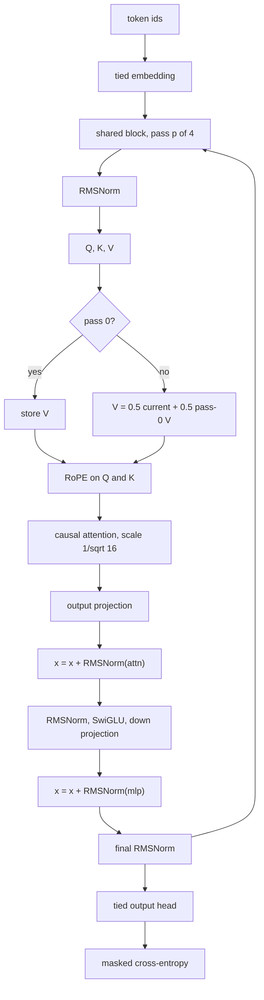

# Architecture

`transformer-metal` is a from-scratch decoder-only trainer. Swift owns the weights, the training loop, and sampling. The arithmetic runs as Metal compute kernels on the Mac GPU. Kernels in `metal/kernels.metal` are compiled at process start with Metal's runtime compiler.

Three models share that runtime. The story model and the tool model are the same looped block at two widths.

| | Shakespeare | MacroStories | Tool calls |
|---|---|---|---|
| Data | character-level Tiny Shakespeare | 8,192 stories sampled from [raincandy-u/MacroStories](https://huggingface.co/raincandy-u/MacroStories) | 4,135 requests, labels fixed before the sentence is written |
| Default size | 4 layers, 4 heads, width 128, about 810k parameters | 19,969 parameters | 1,000,193 parameters |
| Context | 64 | 384 | 64 |
| Precision | int8 GEMM by default, or int4 / fp32 | fp32 only | fp32 only |
| Position | learned absolute | RoPE, theta 10,000 | RoPE, theta 10,000 |
| Block | pre-norm LayerNorm, tanh-GELU, full attention | one shared block, applied 4 times | the same shared block, applied 4 times |
| Optimizer | AdamW on every parameter | Muon on decoder matrices, AdamW on embeddings and RMSNorms | the same split |
| Checkpoint | `TGMT`, `build/model.ckpt` | `TMAC`, `build/macro.ckpt` | `TMAC`, `build/tools.ckpt` |

## Where each step runs

A training step uploads a batch, then records a command buffer of kernel launches.

Shakespeare does the whole update on the GPU: forward, backward, gradient clip, and AdamW. When `--bits` is 4 or 8, forward GEMMs read a quantized copy of the weight. The master weight, the gradient, and the Adam moments stay fp32. After AdamW, the master is quantized again. Backward uses the straight-through estimator: the rounding and the per-group scale are a stop-gradient, and `dW` is the ordinary outer product.

The story model uses the same pattern for the forward pass, the backward pass, the masked loss, and AdamW. Muon is the exception. Its momentum update and the five-step Newton–Schulz orthogonalization run in Swift on the CPU, on gradients the kernels already computed. The decoder matrices are 32 by 32 or 48 by 32, so that CPU step is small next to attention.

## Shakespeare block

Each layer is pre-norm. `C` is the embedding width and `F = 4C` is the MLP width.

```text
h = x + Attn(LayerNorm(x))
y = h + Proj(GELU(Fc(LayerNorm(h))))
```

Attention is causal, with one key and value head per query head. The output head is tied to the token embedding. There is no dropout. The loss is the mean next-character cross-entropy.

The default int8 run is batch 16, block 64, 800 steps, learning rate `1e-3`, weight decay 0.1, gradient clip 1, seed 1337. A fresh model starts near `ln(vocab)`, about 4.17. On an M1 Pro that net trains at about 13k tokens/s. After 1,000 steps the loss is about 2.1.

Quantized weights use one scale for every 8 inputs along an output row. int8 codes are -127..127. int4 packs two codes per byte, range -7..7. `--bits 32` keeps every GEMM in fp32.

`make check` compares kernels to CPU references, then requires a tiny net to memorize one batch. `make overfit` is the same test at the default width.

## Story model

The shape matches the published Ouro student: hidden size 32, SwiGLU width 48, 2 query heads, 1 key/value head, head dimension 16, RoPE, sandwich RMSNorm, a value residual, and a tied 378-word embedding. One decoder block is applied four times with the same weights. The early-exit gate is stored so the parameter count is 19,969, and it is not used. Loss is next-token cross-entropy on the fourth pass only. Pad id 0 is ignored, and that embedding row stays zero.



Key and value are one head of dimension 16, then repeated onto the two query heads. RoPE is applied to Q and K before that repeat, and the value mix happens before RoPE. SwiGLU is `silu(gate) * up`, then the down projection. Linears have no bias. Norms are initialized to 1. Other matrices are `N(0, 0.02)`.

| Group | Shape | Count | Update |
|---|---|---:|---|
| Token embedding, tied to the output head | 378 × 32 | 12,096 | AdamW, decay on |
| Q, K, V, output | 32×32, 16×32, 16×32, 32×32 | 3,072 | Muon |
| SwiGLU gate, up, down | 48×32, 48×32, 32×48 | 4,608 | Muon |
| Five RMSNorms | 32 each | 160 | AdamW, decay off |
| Inactive early-exit gate | 32 + 1 | 33 | frozen |
| **Total** | | **19,969** | |

Muon follows the Keller Jordan update. Momentum uses beta 0.95. The Nesterov look-ahead is orthogonalized with five Newton–Schulz quintic steps, coefficients `(3.4445, -4.7750, 2.0315)`, in fp32, then scaled by `sqrt(max(1, rows/cols))`. AdamW uses beta1 0.9, beta2 0.95, epsilon `1e-8`. The published recipe sets weight decay and gradient clip to 0.

The learning rate is 0.003. For the first 200 steps (5% of 4,000) it warms up linearly. After that it follows a cosine down to about 0. The model seed is 456. On an M1 Pro, batch 32 and block 384 train at about 26k tokens/s, so 4,000 steps take about 30 minutes.

## Data

Tiny Shakespeare is downloaded into `data/input.txt` on the first `make train`. Ninety percent of the bytes are the training split. Each batch is a random window of `block + 1` characters.

The published MacroStories training stories were written by a local Gemma model and were not released. This repo does not train on the public TinyStories corpus. That corpus uses a much larger vocabulary, and 12,096 of these 19,969 parameters are the 378-word embedding.

`scripts/distill_stories.py` loads the published weights and samples 8,192 stories at temperature 0.5 and top-p 0.9, the same settings as the model card. Each story is a list of the shared WordLevel ids, including the start token and the end token. Duplicates are dropped. The file `data/macro-distill.bin` is little-endian:

```text
magic "MDST" | u32 version=1 | u32 count
repeated: u32 length | u32 token ids
```

Every 20th story is held out for validation. In the corpus used for the demo checkpoint, training has 7,782 stories, validation has 410, and the longest story is 195 tokens, so the block of 384 never crops one. Teacher samples at these settings are about 90–140 words. The model card's 100–300 word band includes that range; 300-word samples are uncommon.

Hindi uses the same block, the same optimizer, and a different word list. The stories in `data/hindi-by-hand/` were written directly, then stored as `vocab/hindi.txt` and `data/hindi-stories.bin` in this same MDST layout. Pad, start, and end stay ids 0, 1, and 2. `make stories-hi` trains from that file into `build/hindi.ckpt`. The embedding row count follows the Hindi list, so the parameter total is `vocab × 32 + 7,873` and is not 19,969.

A prompt is encoded with the same word split the tokenizer uses. A leading space is attached to the first word unless the prompt starts with `"` or a bare `I`, because training stories use the space-prefixed form of words like `The`. `Alex`, `Robin`, and `Casey` become the three person tokens, and the space in front of a name is its own token. Any other word is rejected before generation.

## Demo checkpoint

The checked-in procedure writes `build/macro.ckpt`. That file is produced by training from random initialization on the 8,192 teacher stories. It is not a copy of the Hugging Face weights. Final training loss was 0.34 and validation loss was 0.36, against a uniform-guess loss of 5.94.

Stories still repeat a sentence sometimes. The teacher samples do that as well.

```bash
make stories-check
.venv/bin/python scripts/distill_stories.py
make stories
./build/gpt stories-sample --ckpt build/macro.ckpt --seed 17
./build/gpt stories-sample --ckpt build/macro.ckpt --seed 42
./build/gpt stories-sample --ckpt build/macro.ckpt --prompt '"I want to fix this kite," Alex said.'
```

`stories-check` checks the parameter count, a central-difference gradient on the attention, norm, SwiGLU, and embedding weights, then memorizes one fixed flower story.

Seed 17, temperature 0.5:

```text
Alex noticed a small bird near the woods. Alex wanted to build a small birdhouse. Alex and Robin worked together in the yard. The wooden board kept falling over. Alex looked at the board. Robin gripped the board firmly to hold it. Alex took a hammer and some nails. Alex tapped the nails into the wood. Alex pressed the nails into the wood. Alex and Robin worked together. The birdhouse was finished. Alex and Robin placed the birdhouse into a tree. The birdhouse was high in the tree.
```

Seed 42:

```text
"I want to help this flower," Alex said. Alex looked at the dry flower in the village garden. The flower needed water. Alex grabbed a large bucket. The bucket was full of water, but it was too heavy for Alex. Alex looked at the bucket and sighed. Alex grabbed a small cup. Alex dipped the cup into the bucket. Alex walked to the flower and poured the water. Alex went back to the bucket. Alex made several trips. Alex carried the cup back and forth. Alex poured the water again and again. Finally, the flower got enough water. Alex smiled at the flower. The flower looked fresh and bright. Alex felt happy.
```

A kite prompt:

```text
"I want to fix this kite," Alex said. Alex went to the city park. The kite was colorful and paper and colorful. The kite was sad. Alex looked at the gap. Alex grabbed a piece of paper and some glue from a bag. Alex placed the paper patch over the tear. Alex pressed the patch down firmly. Alex waited for the glue to dry. Alex and Robin ran toward the grass. Alex held the string and ran toward the wind. The kite flew high into the sky. Alex smiled because the kite flew again. Alex and Robin watched the kite fly. They were happy.
```

Sampling defaults are temperature 0.5, top-p 0.9, and 640 new tokens, stopping at the end-of-story token. `--seed N` repeats a sample. Omitting `--seed` picks a new one from the clock.

## Shakespeare examples

```bash
make check
make train
./build/gpt sample --ckpt build/model.ckpt --prompt "ROMEO:" --tokens 300 --temp 0.8
./build/gpt train --bits 32 --layers 6 --heads 6 --embd 384 --batch 32 --block 128 --steps 2000
./build/gpt overfit --bits 4
```

## Tool calls

The controller uses the story block with a wider shared layer: embedding width 256, SwiGLU width 758, 4 query heads, 1 key/value head, head dimension 64, and 4 passes. The word list has 987 entries, including `<request>`, `<call>`, and `<refuse>`. The count is

```text
987 × 256 + 165,377 + 3 × 758 × 256 = 1,000,193
```

The first term is the tied word table. 165,377 is attention, the five RMSNorms, and the unused exit gate at this width. The last term is the SwiGLU matrices. Pad, start, end, and unknown stay ids 0 through 3. Loss still ignores pad. The exit gate is still allocated and still unused.

Training is the story recipe: 4,000 steps, batch 32, learning rate 0.003, cosine decay with 5% warmup, Muon on the matrices, AdamW on the embeddings and norms. The block is 64 because the longest request is 33 tokens. At width 256 the Newton–Schulz step is the slow part. On an M1 Pro the run is about 750–860 tokens/s, so 4,000 steps take about three hours. Final training loss was 0.577 and held-out loss was 1.268, against a uniform-guess loss of 6.895. The split is 3,928 training requests and 207 held-out ones, every 20th row of `data/tools/calls.bin`.

Each row is one sentence and one action. The ten tools are `set_timer`, `set_alarm`, `add_reminder`, `send_message`, `create_event`, `get_weather`, `play_music`, `navigate`, `add_note`, and `open_app`. `scripts/distill_tools.py` chooses the tool and the argument values first, then asks a teacher to write a sentence that contains those values. A row is kept only when every value appears in the sentence. A refusal has no tool. The packed file uses the same `MDST` layout as the stories. `vocab/tools.txt` is the word list. The corpus directory `data/tools/` is gitignored; the trained weights are `build/tools.ckpt`.

Greedy generation from the request prefix matches the gold call, including the end token, on 200 of the 207 held-out rows. The misses are short fragments. The model writes one more word of the request, such as turning `tea 25 minutes` into `tea 25 minutes timer`, instead of emitting `<call>`. A colon is split into its own token, so a time is stored and generated as `6: 45`.

```bash
make tools
./build/gpt tools-eval --ckpt build/tools.ckpt
./build/gpt tools-sample --ckpt build/tools.ckpt --prompt "Could you set a timer for 10 minutes for pasta" --temp 0
./build/gpt tools-sample --ckpt build/tools.ckpt --prompt "what is 17 times 4" --temp 0
make demo
```

`tools-sample` prints the decoded continuation. A call looks like `<call> set_timer minutes 10 label pasta`. A refusal is `<refuse>`. `make demo` loads the checkpoint once and serves the controller page at http://127.0.0.1:8787. `demo/controller.mp4` records that page for 24 seconds.

## Checkpoints

A Shakespeare checkpoint starts with the bytes `TGMT`, then the vocabulary bytes and every master weight in creation order. A looped checkpoint, used by both the story model and the tool model, starts with `TMAC`, version 1, then vocab size, block, loops, heads, key/value heads, embedding width, SwiGLU width, the value-mix coefficient, and the parameters in creation order: embedding, Q, K, V, output, gate, up, down, the five norms, and the unused exit gate. The files store fp32 master weights. The int4 or int8 copy is rebuilt when a Shakespeare checkpoint is loaded. The string table is not inside `TMAC`; the tool run reads `vocab/tools.txt` beside `build/tools.ckpt`.
